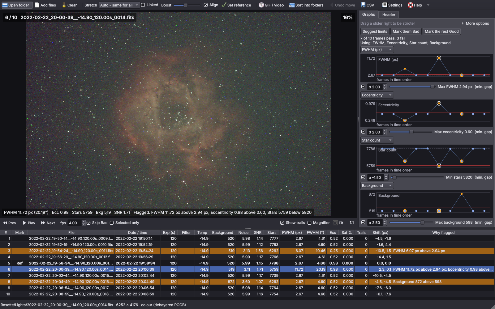
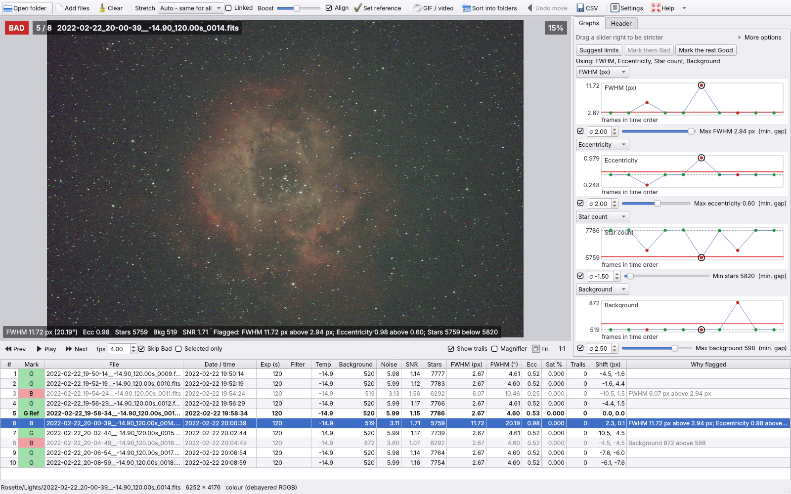
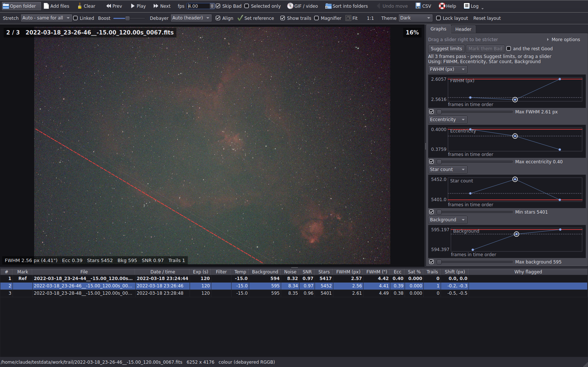
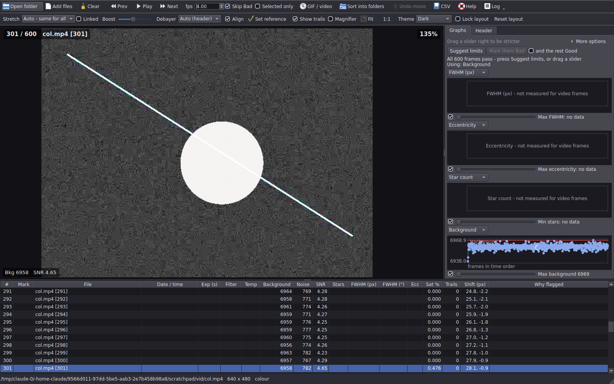

  

<h1 align="center">AS Blink</h1>

A fast, standalone blink comparator for checking astrophotography subs before stacking. 
Free to use - by Stewart Oliver, <a href="https://astroshed.co.uk">AstroShed</a>.

## What it does

Open a folder of subs and AS Blink measures every frame in the background while you blink through them. Bad frames (cloud, poor focus, wind, trails) stand out on the graphs and in the table, so you can mark them and sort them into Good and Bad folders.

- **Reads almost everything:** FITS (including `.fz`), XISF (including compressed), TIFF, PNG, JPG, BMP, WebP, camera RAW (CR2, CR3, NEF, ARW, DNG, ORF, RAF, RW2 and more), SER, and AVI / MP4 / MOV video.
- **Correct colour (OSC) debayering:** reads the Bayer pattern from the header (BAYERPAT, ROWORDER, XBAYROFF / YBAYROFF, XISF colour filter array), checks it against the data, and warns you if the header has it wrong.
- **Statistics for every frame:** background, noise, SNR, star count, FWHM (pixels and arcseconds), eccentricity, saturation, trails and shift.
- **Session graphs** of any measurement through the night, including sensor and focuser temperature, so you can tell whether a rise in FWHM followed the temperature or the seeing.
- **Graphs with sliders:** each graph has a slider that sets a limit. Dragging right is always stricter. **Suggest limits** finds the odd ones out for you, and **Keep only the best** keeps the best part of the session.
- **Trail detection:** finds satellite and aircraft trails, including faint ones, and ignores nebula edges that show up in every frame.
- **Align while blinking:** frames are lined up to a reference frame, including a 180 degree turn after a meridian flip.
- **Auto stretch:** one shared stretch, so cloud and moonlight stand out, or a stretch for each frame for comparing detail.
- **Full header view:** every keyword, with a search box and an option to show only what changed from the previous frame.
- **Magnifier**, fit to window and 1:1 zoom.
- **Mark Good / Bad** with one key, then **sort into folders**. Moves can be undone.
- **GIF or MP4** of selected frames, and **CSV** of the statistics.
- **Videos:** step through SER, AVI, MP4 and MOV files one frame at a time, or play them at 0.5 to 30 frames a second.
- **Themes:** Dark, Light and Night (red). The layout is remembered and can be locked.
- **Support log:** if something goes wrong, **Log > Save log for support...** saves one text file to send in.
- **Update check:** once a day it checks GitHub for a newer version and shows a bar with a link to the download page. Turn it off at the bottom of the Help window.

| Light theme (mono subs) | Trail found |
|---|---|
|  |  |

## Download and install

AS Blink is a Windows program. Nothing needs installing first - everything it uses is included.

1. Go to the [Releases page](../../releases/latest) and download the `.zip` file under **Assets**.
2. Unzip it somewhere permanent, for example `C:\Programs\AS Blink`.
3. Run `AS_Blink.exe` from the unzipped folder. Keep everything in that folder together: the program needs the files next to it.

You can make a desktop shortcut to `AS_Blink.exe`, and you can drag a folder of subs onto the shortcut or onto the open window.

**Windows warning:** AS Blink is not code-signed, so the first time you run it Windows SmartScreen may say "Windows protected your PC". Click **More info**, then **Run anyway**. Some antivirus programs also flag new programs built with Python. If yours does, add an exception for the AS Blink folder.

**Updating:** from 1.0.3 on, AS Blink tells you when a new version is out. Download the new zip from Releases and unzip it over the old folder (or into a new one). Your settings and layout are kept, because they are stored in Windows, not in the program folder.

## Keys

| Key | Does |
|---|---|
| Ctrl+O | Open a folder of subs |
| Ctrl+Shift+O | Add files |
| Space | Play / pause the blink |
| Left / Right | Previous / next frame |
| Home / End | First / last frame |
| G / B | Mark Good / Bad (and move on) |
| U | Clear the mark |
| R | Make this frame the reference |
| A | Align on / off |
| M | Magnifier on / off |
| T | Show trails on / off |
| I | Info overlay on / off |
| F or double-click | Fit to window |
| 1 | 100% (one screen pixel per image pixel) |
| + / -, mouse wheel | Zoom |
| Delete | Remove the selected rows from the list (files on disk are not touched) |
| Ctrl+Z | Undo the last move into folders |
| F1 | Help |

## Rejecting frames

Under each graph is a tick box and a slider. The slider is the limit for that measurement (for example "Max FWHM 3.09 px"), drawn as a red line on the graph. Frames past a limit turn orange. Only measurements that are shown on a graph and ticked are used, so to judge on FWHM and star count alone, untick the others.

**Suggest limits** sets each ticked slider to the session's "odd ones out": frames worse than the typical value by more than twice its usual spread, or by a minimum gap if that is bigger. Frames are only flagged until you press **Mark them Bad**, and nothing is moved until you use **Sort into folders**.

Keep each filter in its own folder: the limits apply to every frame that is open, and AS Blink warns you if a folder mixes filters, exposures or frame sizes.

## Videos (SER, AVI, MP4, MOV)

Every frame of a video becomes a row in the table. Step through it one frame at a time with Left / Right, or play it with Space at any speed from 0.5 to 30 frames a second. Video frames are only read for viewing and their brightness, not measured for stars, so even a long video is ready to play in seconds. To measure stars as well, tick **Measure stars in SER and video frames** in More options.

SER and video files open on the **Linear** stretch, so a planet or the Moon shows its own detail instead of being blown out to white. For a capture longer than 2,000 frames, AS Blink asks whether to load all of it or just a number of frames from a chosen start frame. Load a few hundred, select them all and press G, and **Sort into folders** saves them as a new, shorter SER.

**Sort into folders** writes new SER files holding the Good and the Bad frames of a SER video. Frames inside AVI, MP4 and MOV files are left out of sorting.

## Something not working?

AS Blink keeps a log of what it does: the files it opens (file names only, never the full path or your user name), how each one was measured, any errors, and sorting and exports. Use **Log > Save log for support...** to save it as one text file, and send it with a few words on what you were doing. **Log > Open log folder** shows where it is kept.

## Licence

AS Blink is **freeware**. Copyright (c) 2026 Stewart Oliver, AstroShed.

You may use it free of charge and share it unchanged, but not sell it, modify it or share changed versions without permission. It comes with no warranty, so keep backups of your data. See [LICENCE.txt](LICENCE.txt) for the full terms; it is also included in the download. The libraries it uses each have their own licences.

## Support

If AS Blink saves you time, you can buy me a coffee: [buymeacoffee.com/astroshed](https://buymeacoffee.com/astroshed)

More AstroShed software and videos: [astroshed.co.uk](https://astroshed.co.uk)
